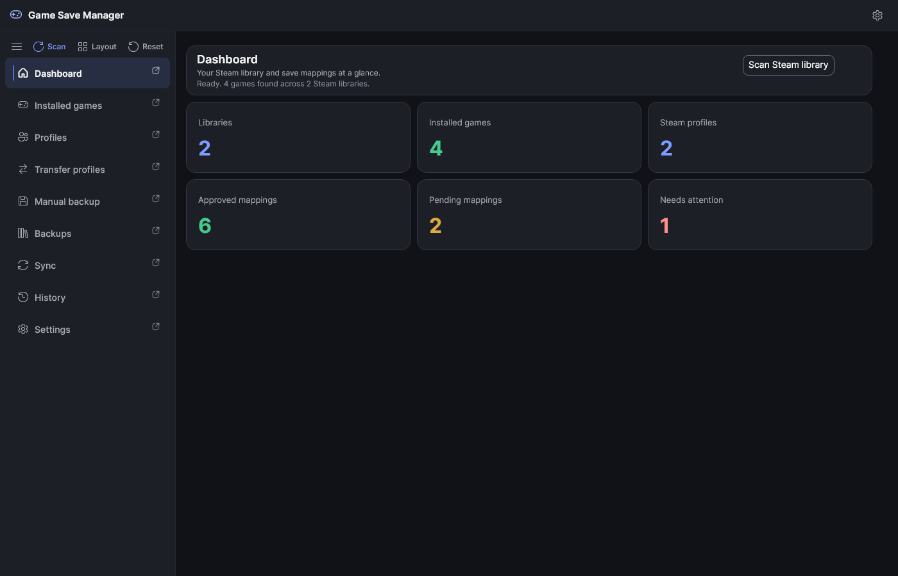
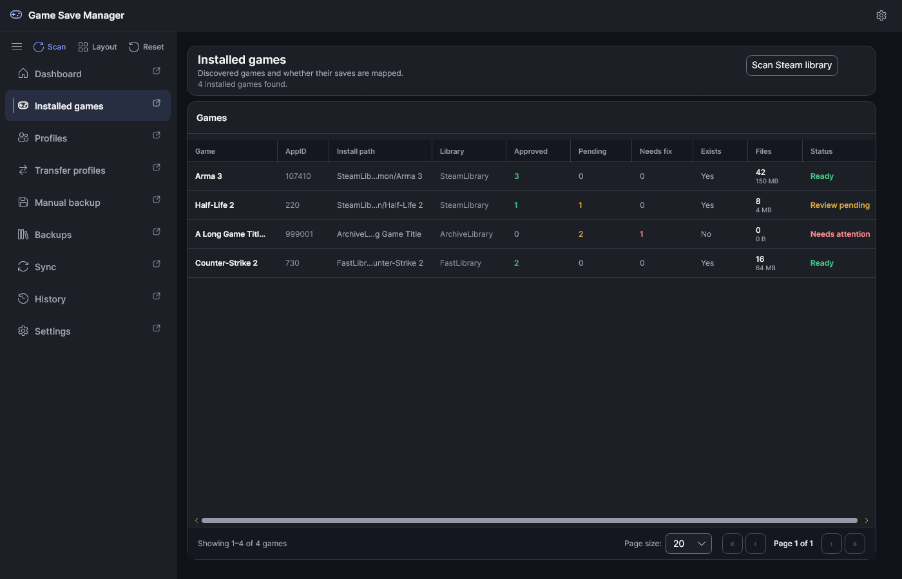
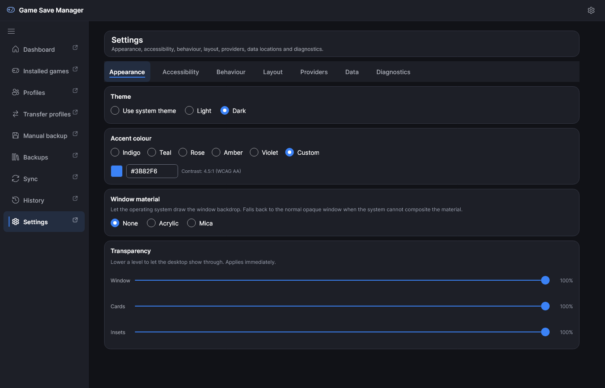
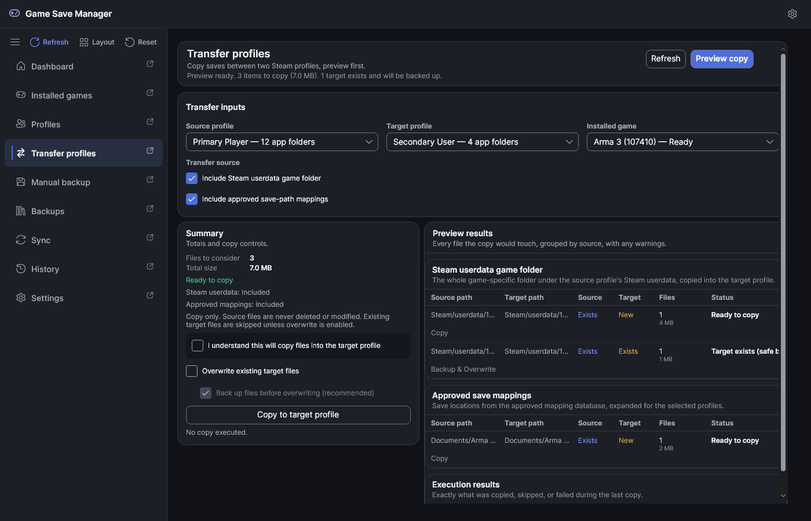
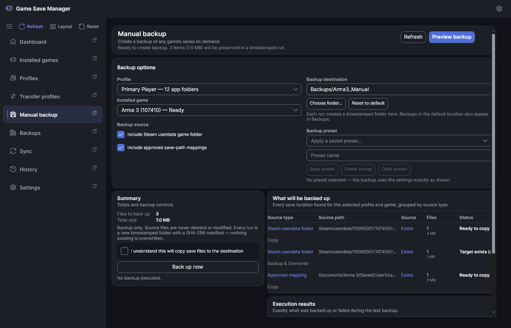
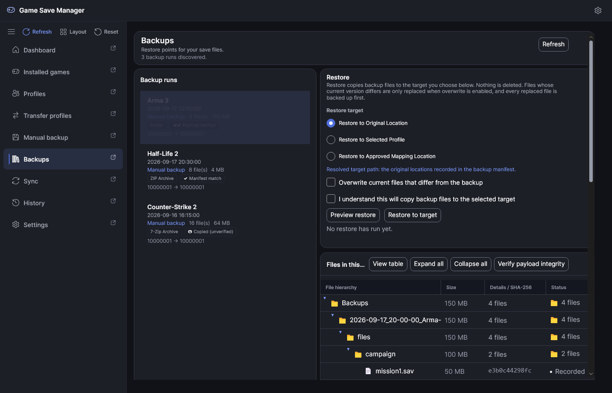
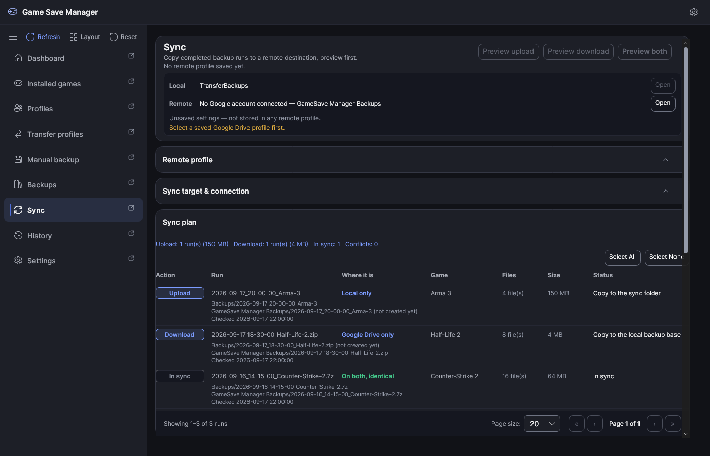

# Desktop Application

This guide owns desktop workflows, navigation, and UI states. Requirements and
launch instructions are in [Getting Started](getting-started.md).

## Startup and navigation

The App opens immediately and loads the Dashboard, Installed games, Profiles,
Transfer profiles inputs, Manual backup inputs, Backups, and History in the
background. Each page shows its own loading, empty, ready, warning, blocked, or
failure state instead of requiring a first manual refresh.

The navigation rail contains nine tabs:

| Tab | Purpose |
| --- | --- |
| Dashboard | Steam discovery summary and first-run actions |
| Installed games | Installed games and approved, pending, or needs-fix mapping state |
| Profiles | Detected Steam profiles and transfer source/target selection |
| Transfer profiles | Preview and execute local profile-to-profile copies |
| Manual backup | Create a new timestamped backup run, or save one as a scheduled backup |
| Backups | Inspect, verify, restore, archive, import, and clean up backup runs |
| Sync | Configure a provider and synchronize completed backup runs, or schedule a saved profile |
| History | Inspect executed transfer, restore, backup, cleanup, and sync results |
| Settings | Appearance, accessibility, behavior, layout, providers, data, and diagnostics |

`Ctrl+1` through `Ctrl+9` address that canonical order. Settings can reorder or
hide eligible tabs and choose the startup tab. Dashboard and Settings stay
visible. The rail can sit on the left, right, or top and can collapse to icons.

The rail's Scan or Refresh action is page-sensitive: it invokes the active
page's existing command and is absent on Settings. A page that is already busy
keeps the same command disabled in both places.

## Workspace layout and recovery

Page sections can be moved between regions, resized, collapsed, hidden, or
floated into their own windows. Entire tabs can also be detached. Closing a
detached tab window reattaches it.

Use a section menu to reset only that page. Use Settings > Layout > Reset
workspace, followed by its confirmation action, to restore all default page
layouts and reattach detached tabs. Settings also exposes hidden sections and
tabs so hiding content never makes it permanently unreachable. Saved workspace
layouts are explicit snapshots and are not applied automatically.

## Window materials

Settings > Appearance offers None, Acrylic, and Mica. None uses the normal app
surface and is opaque by default. Acrylic and Mica request their corresponding
Avalonia transparency levels and apply live when Windows accepts the request.
The main content can expose the system backdrop, while the primary rail,
Settings categories, menus, and tooltips remain opaque.

If Windows denies or substitutes the requested level, all attached and detached
windows keep the safe opaque fallback. High Contrast always disables window
materials and keeps every surface opaque. Remote sessions, older Windows
versions, power settings, and Windows composition policy can affect support;
that is a platform fallback, not evidence of save-data corruption.

A custom accent accepts `#RGB` or `#RRGGBB` and applies when focus leaves the
box; the box is enabled only while Custom is selected. The App adjusts the
accent's lightness so accent text keeps at least 4.5:1 contrast on dark cards
and on the light page, and the readout reports both ratios.

## Transfer profiles

1. Choose distinct source and target Steam profiles.
2. Choose the Steam userdata game folder, approved mappings, or both.
3. Build the preview. Equivalent paths are deduplicated.
4. Resolve blockers or explicitly choose to skip blocked items.
5. Review file counts, sizes, conflicts, targets, and overwrite state.
6. Confirm execution. Overwrite remains off unless explicitly enabled.

The Steam userdata path is validated independently of the mapping database.
Only approved mappings can supply additional paths. When Safe Mode overwrite is
enabled, each target is backed up before replacement; a backup failure blocks
that file.

## Manual backup

Choose a profile, installed game, source set, and destination. The destination
can be typed or selected with the native folder picker. Every execution creates
a fresh timestamped run with mirrored source paths and a SHA-256
`manifest.json`; it does not replace a previous run. New runs are compressed
ZIP archives unless [Backup storage](#backup-storage) says otherwise.

Named presets store the destination and source choices. Applying or deleting a
preset never starts a backup and never deletes backup data. Runs written under
the application backup base appear in Backups; custom destinations remain
self-contained but are not indexed there.

## Scheduled backups

A scheduled backup runs one game's backup on a schedule, without opening the
window. Nothing is scheduled by default. To schedule one:

1. Preview a backup on the Manual backup page.
2. In the Scheduled backups panel, pick **Daily** or **Weekly** (with a day) and
   a time.
3. Select **Save as scheduled backup**. The button stays disabled until the
   current preview is clean.

The job stores the game, the Steam profile, the destination, and the two source
switches. The app registers a Windows task for it in Task Scheduler's
`Game Save Manager` folder. The task runs `GameSaves.App.exe --run-job <id>`.

The task runs as you, without administrator rights, and only while you are
signed in. No password is stored. Your jobs, History, settings, and cloud sign-ins
live in your Windows profile and are protected for your user, so a task that
ran while you were signed out could not use them. When a scheduled time is
missed, for example because the computer was off, Windows starts the run as
soon as it can afterwards. If a run is still going when the next one is due,
Windows skips the new one.

Each job in the panel shows:

- its schedule and the task's state (Ready, Running now, or Disabled in Task
  Scheduler);
- the last run time with its result in words, and the next run time;
- the outcome the last run recorded;
- a warning when the job and its task disagree.

The app reports these mismatches and never repairs them on its own:

- **No Windows task.** Registration failed, or the task was deleted in Task
  Scheduler. Nothing runs.
- **A different program.** The task starts another copy of the app, for
  example after the app moved to a new folder.
- **Changed arguments.** The task's arguments no longer name the job.

**Apply schedule** on a job registers its task again with the schedule picked
above and points it at this copy of the app. It fixes all three mismatches,
changes the schedule, and enables a task that was disabled in Task Scheduler.
A schedule edited in Task Scheduler into something the app does not offer is
shown as a custom schedule.

If Windows refuses to register or update a task, the panel says why and nothing
else changes. A new job is kept without a task until Apply schedule succeeds.

Each run checks the job again before it writes anything. It refuses when the
destination folder is missing, the game is no longer installed, the profile is
gone, or the preview finds nothing to back up. It never creates a missing
destination, because that usually means an unplugged drive. A run adds a new
backup run in the format chosen under [Backup storage](#backup-storage) and
never replaces or deletes anything. Every outcome, refusals included, appears
in History as a **Scheduled backup** row and on the job as its last outcome.

**Remove** deletes the job's Windows task first and then the job. If Windows
refuses to remove the task, the job is kept so that nothing is left running
without it. Backups the job already made and its History rows are kept.

A task without a job, left by an older copy of the app or a restored database,
is listed under **Windows tasks without a saved job** with **Remove task**.
Scheduled backups and [scheduled syncs](#scheduled-syncs) share the same task
folder, so this list covers both kinds: a task that belongs to a scheduled sync
is never offered here as a leftover, and a sync task whose job is gone is.
Until it is removed, each of its runs is refused and recorded in History.

The app manages only the tasks it registered in its `Game Save Manager` folder.
A task you created by hand for a job is not shown or removed by the app. Delete
it in Task Scheduler, then use Apply schedule on the job.

The exit code of `GameSaves.App.exe --run-job <id>` (and of `--run-sync <id>`,
see [Scheduled syncs](#scheduled-syncs)) reports the outcome:

| Code | Meaning |
| --- | --- |
| 0 | Completed |
| 1 | The command line was malformed |
| 2 | Refused before anything was written |
| 3 | Skipped because the previous run of this job is still running |
| 4 | Failed; nothing that existed before the run was changed or removed |

## Backups and restore

Backups discovers manifest-bearing runs and displays their files, sizes, game,
profiles, and timestamp. Restore always begins with a preview and can target:

- original recorded locations;
- the matching game's userdata folder for a selected profile; or
- one approved, enabled mapping that resolves to exactly one path.

Existing files are skipped by default. An explicitly enabled restore overwrite
first backs up the current target. Hash-mismatched or missing backup files are
not restored.

Runs start as unverified. Verify hashes the run's payload against its manifest
and shows Payload verified, Payload mismatch, or Payload missing; selecting
another run cancels a check in progress and leaves the badge unchanged. The
file tree starts at each file's original location.

**Compare with another run** shows what the selected run adds, removes, or
changes against a baseline run picked from the same list. Added means the
file is in the selected run but not in the baseline; removed, in the baseline
but not in the selected run; changed, in both with a different SHA-256. The
table lists each file with its class in words, both sizes, and both hashes,
with filters per class (identical files are hidden until asked for) and a
summary of counts and bytes per class. Only the two manifests are read: no
payload is opened, extracted, downloaded, restored, or verified, so a hash
that matches says the recorded hashes agree, not that the files were checked.
A manifest that cannot be trusted (missing, incomplete, an unsupported schema,
an unsafe or duplicated path, or one hash with two sizes) is refused with that
reason and no table. Selecting another run clears the comparison; Cancel stops
a long one and shows nothing partial.

ZIP export creates a self-contained archive; a run that is already compressed
is copied as it is. Import validates extraction, rewrites manifest paths to the
imported location, and never overwrites an existing run. Cleanup is the only
user-backup deletion feature; its exact boundary is owned by the
[safety model](safety-model.md).

Compressed runs restore directly, with the same preview, targets, and overwrite
rules as folder runs. The archive's own manifest is read, the payload is
unpacked into a private staging copy under the import limits, and every file is
hashed against the manifest before any current file is replaced. A tampered,
truncated, or unreadable archive is refused with its reason and nothing is
restored; the staging copy is removed either way.

## Backup storage

Settings > Behaviour > Backup storage chooses how new backups are stored:
Compressed ZIP (the default; opens in Windows without extra tools), Compressed
7-Zip (smaller, slower to write), or Uncompressed folder. The choice covers
manual backups and the automatic backups taken before a transfer or restore
overwrites a file, and applies from the next backup on. Backups already on disk
keep their format; nothing is converted.

A compressed run is written as a folder first, without a manifest, so it is
never listed half-built. On completion its files and manifest are packed into a
temporary archive, every file is read back and hashed against the manifest, and
only then is the archive renamed to `<run>.zip` or `<run>.7z` and the staged
folder removed. If any step fails, or a file of that name already exists, the
run is kept as an ordinary folder run instead. Backups shows each run's format
in words (ZIP Archive, 7-Zip Archive, or Folder), and Sync sends a compressed
run as its own container.

## Sync

Select a saved or unsaved remote profile, configure Local Folder, SFTP,
Google Drive, WebDAV, or OneDrive, and run Check Connection & Sync Status. Saving or selecting a
profile does not connect, preview, or sync.

Both endpoints are named before any preview runs: the local backup base, and
the configured remote as the user configured it. Local Folder shows its
resolved directory, SFTP shows host, port, and remote path but never a
credential, and Google Drive shows the connected account and the backup
folder's display name but never its internal folder ID. Settings that belong to
no saved profile say so rather than looking like one, and missing configuration
is named before the preview rather than after it. Either side can be opened
where the provider declares that capability and the location is actually
reachable; opening a location transfers nothing.

Preview upload, Preview download, and Preview both build the plan in one
direction or both. All three are dry runs. Once a plan is ready, the button
for the direction it was built in becomes the action that runs it, named for
exactly what it will copy ("Upload 6 run(s) (93.9 MB)"); the other two stay
previews, and any settings change turns all three back into previews.

Each plan row says where the run currently is - local only, remote only,
present on both and identical, present on both and conflicting, or incomplete
and therefore unverifiable - along with both display locations, the file count
and size where they were actually measured, and when both sides were last read.
The visible Upload or Download action is itself the selection: clicking it, or
pressing Space on it, includes or excludes that run, and Select All and Select
None write the same state. Conflicts and already-synced runs are not selectable.

WebDAV takes an https server URL, a user name, and a folder for the backups.
Save the profile first; then enter the password or app password and choose
Store password, which encrypts it for the current Windows account under that
profile and clears the box. Forget password removes it again. A preview always
uses the saved settings, so unsaved edits have to be saved before previewing.

That press is the confirmation: the plan is on screen and the button says
what it copies. Execution reports byte and run progress and can be cancelled.
Conflicts, deselected items, and existing targets remain untouched.

Transfer runs as compressed archive sends each run as one `.7z` file plus its
manifest instead of one request per file. Every provider, Google Drive
included, stores and lists runs that way, and they are imported back as
folder runs.

The "Upload to several profiles" panel uploads the local runs to several saved
profiles in one go: tick the profiles, preview (one dry run per profile), then
press the action that the preview button turns into. Profiles run one after
another, each shows its own outcome, one failing does not stop the others, and
each is recorded separately in History. SFTP profiles are not offered because
their passwords are never stored; downloads stay a single-profile operation.
See the [provider guide](sync-providers.md#uploading-to-several-profiles).

The "Provider health and storage" panel checks, when Check now is pressed,
whether each saved profile answers and how much free space its provider
reports. Each row says Healthy, Rate limited, Storage full, or Unavailable in
words with the provider's reason, and shows a storage figure only when the
provider returned one; otherwise it says whether the provider never reports
space or did not report it this time. Checks run one after another, only read,
never open a sign-in, and Stop checking cancels them. See the
[provider guide](sync-providers.md#provider-health-and-storage).

Transfer completion and verification are separate states. After a sync, the
completed runs are re-read through the provider's own preview and reported one
by one: verified in sync, copied but missing on one side, copied but different,
or copied with the check unavailable or cancelled. That check is read-only - it
never copies, moves, deletes, or repairs either side - and it can be retried
without repeating a transfer that already succeeded. A run that was copied is
never described as verified until both sides have actually been read again.

Provider-specific authentication, controls, and limitations belong to the
[sync provider guide](sync-providers.md).

### Scheduled syncs

A scheduled sync runs one saved profile's sync on a schedule, without opening
the window. Nothing is scheduled by default. To schedule one:

1. Select a saved profile on the Sync page and build a preview (upload,
   download, or both, with or without compressed archives). The preview must
   be clean, and the profile must be saved: unsaved changes have to be saved
   first, because a run uses the saved profile, not the fields on screen.
2. In the Scheduled syncs panel, pick **Daily** or **Weekly** (with a day) and
   a time.
3. Select **Schedule this profile**. The button stays disabled until the
   current preview is clean, and changing the profile, the direction, or the
   archive setting discards the preview.

The schedule stores the profile's identity, the direction, and the archive
setting, not a list of runs: each run copies whichever backup runs are missing
on one side at that time, including runs made after the schedule was saved.
One schedule exists per profile. The app registers a Windows task for it in
Task Scheduler's `Game Save Manager` folder, next to the scheduled backups,
that runs `GameSaves.App.exe --run-sync <id>` under the same rules: as you,
without administrator rights, only while you are signed in, with no stored
password, starting a missed run when it can and never starting a second
instance.

SFTP profiles cannot be scheduled, because their passwords and key passphrases
are never stored and a run with nobody at the keyboard could not sign in. The
panel says so. Local folder profiles need no sign-in; Google Drive, OneDrive,
and WebDAV profiles use the sign-in or password stored for the profile, which
refreshes silently and is never requested in a browser by a scheduled run.

Each run reads the saved profile again and checks, in this order, that the
schedule still exists, no other run for the same profile is in progress, the
profile still exists, the local backup folder exists, the provider can run
unattended, the stored sign-in exists, the provider reports healthy (rate
limited, storage full, and unavailable all refuse, with the provider's
reason), and a fresh preview has no errors. It refuses on the first failure
and copies nothing. A run with nothing to copy, including one where only
conflicts remain, completes with nothing copied and says so. Otherwise it runs
the ordinary sync: upload and download stay create-only, conflicts are skipped,
and nothing on either side is replaced or deleted. A run that stops part way
is recorded as failed, never as success.

Every outcome appears in History as a **Scheduled sync** row named after the
profile, and on the schedule as its last outcome. An executed sync is recorded
once, by the sync engine; refusals are recorded by the runner. Each row in the
panel shows the profile, provider, and direction, the schedule and task state,
the last and next run, the last outcome, and the same mismatch warnings as
scheduled backups, which **Apply schedule** fixes. **Refresh** reads the
schedules and tasks again; the page also reads them each time it is shown.
Reading never changes a task.

**Remove** deletes the schedule's Windows task first and then the schedule;
if Windows refuses, the schedule is kept. Backup runs on both sides and
History are never touched. A profile with a schedule cannot be deleted until
its schedule is removed, so no task is left firing for a missing profile.
Renaming or editing a profile needs no change to its schedule: the next run
reads the saved profile as it is then. A manual sync of the same profile from
the window is not blocked by a scheduled run and does not block one; both are
create-only, so the second to reach a run skips it as already present.

## UI state conventions

- **Loading:** the current command is disabled while work is in flight.
- **Empty:** the page explains what is missing, such as Steam, profiles, runs,
  or a selected provider, and offers the relevant next action where possible.
- **Ready:** configuration is sufficient to preview or inspect.
- **Warning:** work may proceed only where the plan remains safe.
- **Blocked:** the page states which required selection, confirmation, path,
  authentication, or invariant is missing.
- **Failure:** a sanitized message is shown; credentials, raw provider payloads,
  account IDs, and Drive object IDs are not displayed.

## Visual documentation gallery

For an exhaustive gallery of all screens, virtualized data tables, cloud synchronization states, appearance modes, and custom accent palette showcases, see the [UI Screenshot Gallery](gallery.md).
