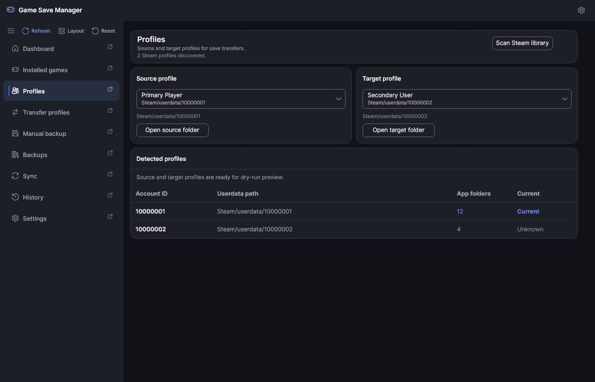
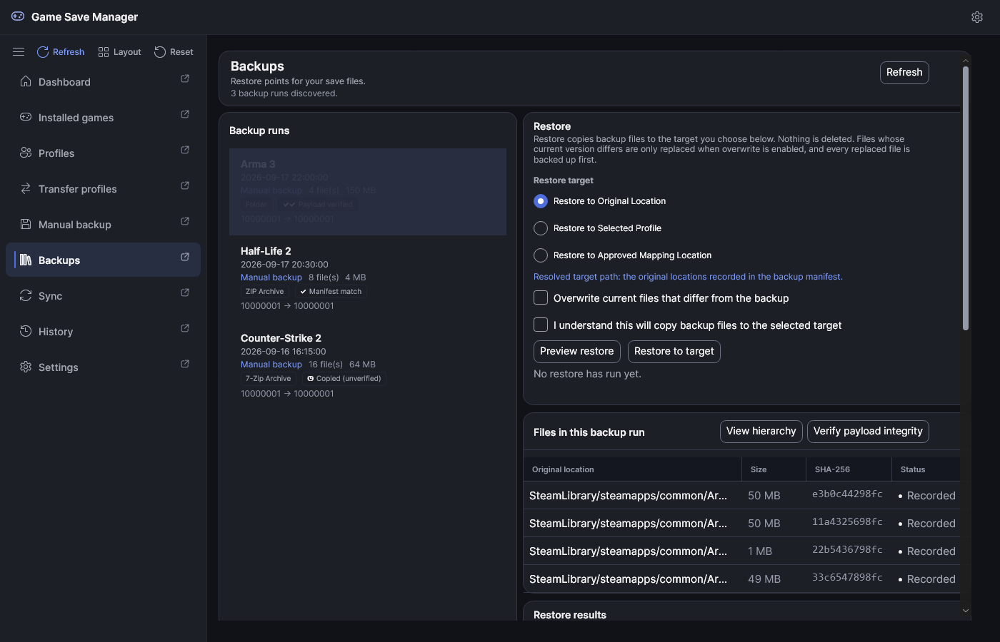
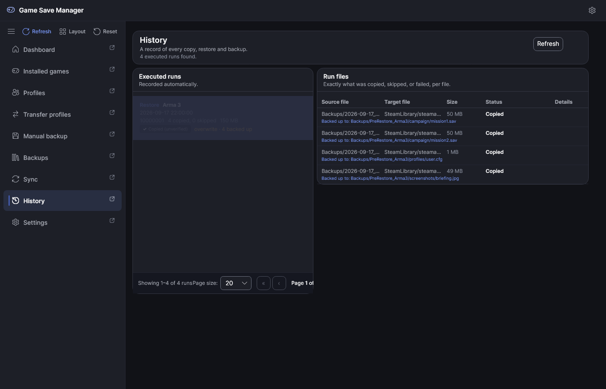
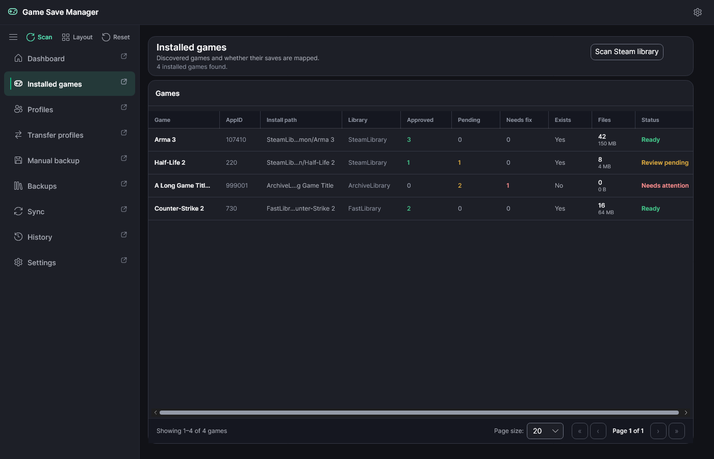

# UI Screenshot Gallery

This gallery documents the GameSave Manager desktop interface across its primary workflows, states, and appearance themes.

> [!NOTE]
> **Sanitization & Determinism Guarantee:** Every capture in this gallery is generated deterministically using the headless capture harness (`Manager/GameSaves.UiCapture`). All displayed data (accounts, paths, game titles, saves, and timestamps) is 100% synthetic. No private Steam IDs, local user directory names, cloud tokens, or personal game saves are ever read or rendered into pixels.

---

## Gallery Index

- [1. Dashboard & Discovery](#1-dashboard--discovery)
- [2. Installed Games & Pagination](#2-installed-games--pagination)
- [3. Steam Profiles](#3-steam-profiles)
- [4. Profile Transfers & Safety Previews](#4-profile-transfers--safety-previews)
- [5. Manual Backups](#5-manual-backups)
- [6. Backup Runs & File Hierarchy](#6-backup-runs--file-hierarchy)
- [7. Cloud Synchronization Plan](#7-cloud-synchronization-plan)
- [8. Operation History & Audit](#8-operation-history--audit)
- [9. Appearance, Materials & Custom Accents](#9-appearance-materials--custom-accents)
- [10. Workspace Layout Customization](#10-workspace-layout-customization)
- [Technical Manifest](#technical-manifest)

---

## 1. Dashboard & Discovery

The Dashboard tab gives an immediate visual summary of the local Steam installation, discovered libraries, installed games, and profile save-path mapping statuses.

* **Key Elements:**
  * **Stat Cards:** At-a-glance counters for Steam libraries, installed games, Steam profiles, approved mappings, pending mappings, and mappings needing attention.
  * **Navigation Rail:** Persistent left rail providing access to all 9 primary application views, status indicators, and page-sensitive actions.
  * **Status & Readiness:** Live status readout displaying discovery readiness.
* **Authoritative Guide:** [Desktop Application](desktop-app.md#startup-and-navigation)

---

## 2. Installed Games & Pagination

The Installed Games tab displays all discovered Steam games, showing install directories, library locations, save mapping counts, on-disk save status, file counts, total size, and readiness status.

* **Key Elements:**
  * **Status Badges:** Colour-coded readiness badges indicating `Ready` (green), `Review pending` (amber), and `Needs attention` (red).
  * **Mapping Counters:** Columns detailing approved, pending, and needs-fix save-path definitions.
  * **DataGrid Pagination:** Virtualized pagination bar with page size selector (10, 20, 50, 100) and previous/next page navigation controls.
* **Authoritative Guide:** [Desktop Application](desktop-app.md#startup-and-navigation) and [Database & Mappings](database-and-mappings.md)

---

## 3. Steam Profiles

The Profiles tab lists all detected Steam user profiles discovered under the Steam userdata directory, displaying account names, 64-bit Steam IDs, managed game folder counts, and primary active status.

* **Key Elements:**
  * **Profile Cards:** Discovered account details with synthetic 32-bit and 64-bit Steam IDs (`10000001` / `76561198000000001`).
  * **Transfer Configuration:** Source and target profile dropdowns enabling cross-profile save migration.
* **Authoritative Guide:** [Desktop Application](desktop-app.md#transfer-profiles)

---

## 4. Profile Transfers & Safety Previews

The Transfer Profiles tab allows safe copying of game saves between two Steam profiles. It features a complete pre-flight preview detailing every file that will be copied or backed up before execution.

* **Key Elements:**
  * **Preview Grouping:** Grouped file views distinguishing Steam userdata game folders and database-approved save mappings.
  * **Conflict & Safety Status:** Explicit file-level indicators (`Ready to copy`, `Target exists (safe backup before overwrite)`).
  * **Safety Invariants:** Execution requires explicit confirmation checkboxes. Target files are automatically backed up to a timestamped folder prior to replacement.
* **Authoritative Guide:** [Desktop Application](desktop-app.md#transfer-profiles) and [Safety Model](safety-model.md)

---

## 5. Manual Backups

The Manual Backup tab enables creating timestamped, isolated archive runs for any installed game's saves on demand.

* **Key Elements:**
  * **Source Selection:** Choose between Steam userdata folders, approved external mappings, or both.
  * **Backup Destination Presets:** Configurable destination folders with preset save/load/delete capabilities.
  * **Pre-Execution Inspection:** Displays file counts, aggregate sizes, and planned actions prior to initiating the backup.
* **Authoritative Guide:** [Desktop Application](desktop-app.md#manual-backup) and [Safety Model](safety-model.md)

---

## 6. Backup Runs & File Hierarchy

The Backups tab discovers all timestamped backup runs with SHA-256 manifests. It supports dual viewing modes: a virtualized hierarchical tree view and a flat table view.

### Hierarchical Tree View (UI-015)

* **Key Features:**
  * **Folder Expanders:** Interactive chevron glyphs with expand/collapse controls and Expand All / Collapse All buttons.
  * **Depth Indentation:** Clean visual hierarchy with folder/file glyphs.
  * **Aggregated Sizes:** Automatic size rollup for directories and nested files.
  * **Verification Badges:** Cryptographic verification indicators (`PayloadVerified`, `ManifestMatch`, `Copied`).

### Flat Table View

* **Key Features:**
  * **Column Sorting:** Sortable columns for file paths, archive types, byte sizes, and timestamps.
  * **Format Badges:** Distinct visual badges for directory, ZIP, and 7-Zip backup archives.
* **Authoritative Guide:** [Desktop Application](desktop-app.md#backups-and-restore)

---

## 7. Cloud Synchronization Plan

The Sync tab facilitates synchronizing completed backup runs to local or remote destinations (e.g. Google Drive, SFTP, Local Folder).

* **Key Elements:**
  * **Endpoint Transparency:** Clear display of local backup base and remote target without exposing private credentials or internal tokens.
  * **Presence Status Chips:** Granular status indicators (`Local only`, `Google Drive only`, `On both, identical`).
  * **Directional Actions:** Action buttons (`Upload`, `Download`, `In sync`) that toggle transfer scope before execution.
  * **Audit Summary:** Real-time summary of runs and byte counts pending upload, download, or already synchronized.
* **Authoritative Guide:** [Desktop Application](desktop-app.md#sync) and [Sync Providers](sync-providers.md)

---

## 8. Operation History & Audit

The History tab maintains an immutable audit log of all executed transfer, restore, manual backup, and cloud sync operations.

* **Key Elements:**
  * **Execution Overview:** Chronological list of runs with operation kinds (`Restore`, `Sync`, `TransferCopy`, `ManualBackup`), timestamps, and transfer metrics.
  * **File-by-File Audit:** Selecting any run displays the detailed file list showing source paths, target paths, sizes, completion statuses (`Copied`), and pre-overwrite backup paths.
* **Authoritative Guide:** [Desktop Application](desktop-app.md#desktop-application) and [Safety Model](safety-model.md)

---

## 9. Appearance, Materials & Custom Accents

The Settings tab provides appearance customization, including theme modes (Light, Dark, System), window materials (None, Acrylic, Mica), and custom accent colours.

### Custom Accent Color & WCAG AA Contrast (OBS-022)

* **Key Elements:**
  * **Theme Choice:** Radio buttons for System, Light, and Dark variants.
  * **Accent Color Presets:** Shipped presets (Indigo, Teal, Rose, Amber, Violet).
  * **Custom Hex Color Input:** Hex color input supporting 3, 6, and 8-digit formats (`#3B82F6`).
  * **Live WCAG AA Contrast Readout:** Real-time contrast ratio calculator (e.g. `Contrast: 4.5:1 (WCAG AA)`) ensuring primary button text meets accessibility standards.
  * **Window Transparency:** Independent opacity sliders for window, cards, and inset surfaces.

### Emerald Accent Theme Showcase

* **Key Elements:**
  * **Dynamic UI Theming:** The entire interface dynamically adapts to custom hex palettes (here shown with Emerald `#10B981`) while maintaining readable contrast across tabs, headers, buttons, and status chips.
* **Authoritative Guide:** [Desktop Application](desktop-app.md#window-materials)

---

## 10. Workspace Layout Customization

The multi-region workspace allows users to reposition, dock, collapse, hide, or float individual panels within each page.

* **Key Elements:**
  * **Flexible Docking:** Drag panels between left, center, and right regions or reorder them sequentially.
  * **State Persistence & Recovery:** Section context menus and Settings > Layout > Reset Workspace provide instant layout recovery.
* **Authoritative Guide:** [Desktop Application](desktop-app.md#workspace-layout-and-recovery)

---

## Technical Manifest

| Filename | View / Tab | Description | Dimensions | Theme | Sanitized |
| --- | --- | --- | --- | --- | --- |
| `00-dashboard.png` | Dashboard | Steam discovery summary and readiness status | 1400x900 | Dark | Yes |
| `01-installed-games.png` | Installed Games | Game library with save mappings and pagination | 1400x900 | Dark | Yes |
| `02-profiles.png` | Profiles | Discovered Steam user profiles and transfer inputs | 1400x900 | Dark | Yes |
| `03-transfer-preview.png` | Transfer Profiles | Profile-to-profile copy preview with conflict checks | 1400x900 | Dark | Yes |
| `04-manual-backup.png` | Manual Backup | Timestamped backup creation with destination presets | 1400x900 | Dark | Yes |
| `05-backups-tree.png` | Backups (Tree) | Virtualized file tree with folder size rollups | 1400x900 | Dark | Yes |
| `05-backups-table.png` | Backups (Table) | Flat file DataGrid with format badges and sorting | 1400x900 | Dark | Yes |
| `06-sync-plan.png` | Sync | Cloud sync plan with presence chips and direction toggles | 1400x900 | Dark | Yes |
| `07-history.png` | History | Executed transfer/backup/sync runs with file audit | 1400x900 | Dark | Yes |
| `08-settings-appearance.png` | Settings | Appearance settings with custom hex and WCAG AA ratio | 1400x900 | Dark | Yes |
| `09-custom-accent.png` | Theme Showcase | Dynamic emerald accent theme (#10B981) in dark mode | 1400x900 | Dark | Yes |
| `10-workspace-layout.png` | Workspace | Multi-region panel layout and docking customization | 1400x900 | Dark | Yes |
